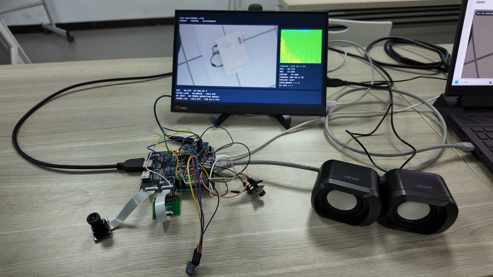
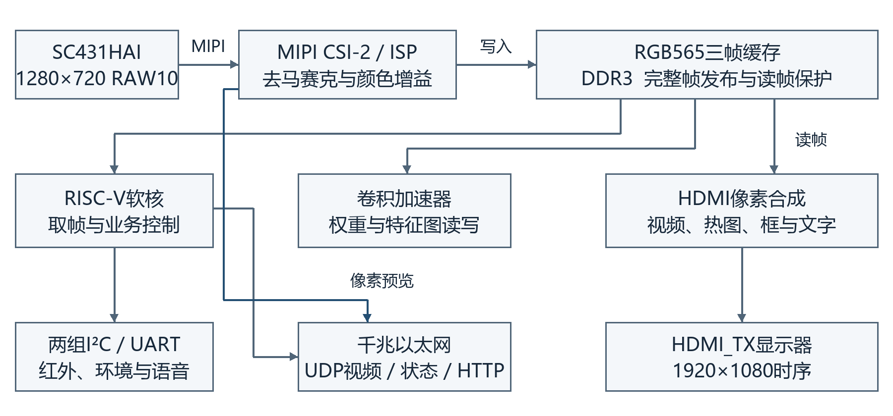

# 岁宁 · 居家安全监护系统

基于易灵思 Ti60F225I3-V4 的多模态辅助看护系统。FPGA 处理摄像头和 HDMI 数据流，Sapphire RISC-V 软核协调人体检测、双人跟踪、温湿度、红外阵列、UART 语音和局域网服务。

[完整演示与 Android 安装包](https://github.com/jiangheliushang23/ti60-multimodal-ai/releases/tag/v24-transfer-opt) · [44 页作品报告](docs/report.pdf) · [BOM、接线与运行](docs/suining-build.md) · [参考资料](docs/references.md)

## 系统功能

- HDMI 同屏显示场景视频、红外热图、温湿度及人体状态。
- 192 × 96 INT8 模型利用 FPGA 加速卷积。按人员 ID 分别判断跌倒，保留红框至站起确认，并通过 UART 语音模块播报。
- 无人时降低摄像头帧率并暂停模型推理。红外热区触发恢复，等待视觉确认。
- RISC-V 板端 HTTP 提供状态、事件与快照。PC 服务接收彩色预览，网页和 Android App 可查看状态与事件回放。

## 工程入口

| 模块 | 入口 |
| --- | --- |
| FPGA 项目、RTL 和引脚约束 | [Ti60_Multimodal.xml](fusion/ti60_yolo_auto/Ti60_Multimodal.xml) |
| RISC-V 固件 | [tinyml_yolo_static](fusion/demo_multimodal/software/standalone/tinyml_yolo_static) |
| PC 监控和 Web | [network_monitor](network_monitor) |
| Android App | [mobile_app](mobile_app) |
| RTL 与固件测试 | [fusion/tests/yolo_auto](fusion/tests/yolo_auto) |
| 外壳试配样机 | [机械爆炸图和合壳图](docs/images/enclosure-prototype.png) |
| Android 界面 | [实机界面图](docs/images/android-app.png) |

源码快照对应 `yolo_auto_v24_transfer_opt`。浏览器与 PC 服务可以单独运行。FPGA 和完整 RV32 构建需要按清单补齐授权 IP、ROM、库及模型。构建方法和对应校验值见文档。[构建说明](docs/suining-build.md) · [依赖指纹](docs/build-dependencies.json)

作品报告和视频记录赛题阶段的实机演示。v24 固定版本的清单标记为 `PENDING_V24_NO_HARDWARE`。各项实现的证据边界和公开附件校验值见 [v24 发布记录](docs/v24-release.json)。

## 授权与来源

项目源文件及素材按原作者署名，第三方代码保留原版权与许可。项目级开源授权以团队另行公布的条款为准。[第三方说明](docs/third-party.md)

## 历史工程

[早期工程与团队协作入口](docs/LEGACY_README.md)记录 2026 年 10 月的融合基线。
