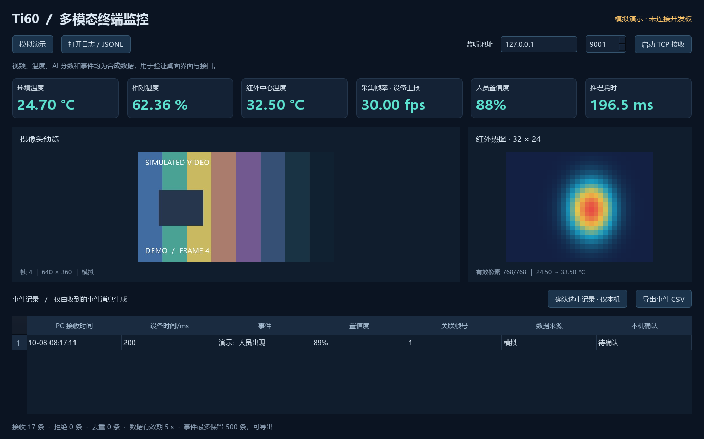

# Windows 桌面监控首版

用户于 2026-10-08 确定使用 Windows 桌面程序，真实数据联调待办为 [Issue #7](https://github.com/jiangheliushang23/ti60-multimodal-ai/issues/7)。Python + Qt Widgets 实现，不依赖 Web 前端；通信草案见 [接口文档](../../docs/HOST_PROTOCOL.md)。

## 已实现

- 左侧视频预览、右侧 32×24 热图，上方温湿度、红外中心温度、设备上报采集帧率、人员置信度和推理耗时。
- 明确区分模拟、历史日志回放与 TCP 输入；没有数据/无效/超过 5 秒的数据不显示为有效读数。
- 现有 CAM/SHT/IR 串口日志回放；SHT 序号表示、状态、年龄、BCD 和范围检查。
- TCP JSONL 消息接收、分包/粘包处理、断线重连、按设备启动标识和消息类型去重。
- 事件去重、本机确认和带来源标记的 CSV 导出；最多保留 500 条，退出后内存记录消失，需手动导出。
- 模拟演示含合成视频、合成热图、示例分类分数与示例事件，持续标明“模拟演示 · 未连接开发板”。

当前未实现串口实时连接、硬件控制、数据库持久化或网络流媒体协议。TCP v1 是桌面实现的**联调草案**，队友尚未确认或在 FPGA 实现。不能把桌面模拟/主机 TCP 测试当作 Ti60 以太网、板端 Web 或 AI 实板验收。

现有串口仅提供视频状态和红外 min/max/center，不含像素，回放时不会凭统计量生成真实视频或热图；真实预览需队友传输像素。首版 JPEG 消息用于联调/低帧率预览，不能据此承诺 720p30 网络视频。最终视频承载方式由通信队友结合带宽和板端资源确定。

## 安装与运行

从仓库根目录执行（Python 3.12 / Windows）：

```powershell
python -m venv host/desktop/.venv
& ./host/desktop/.venv/Scripts/python.exe -m pip install -r host/desktop/requirements.txt
& ./host/desktop/run.ps1 -Demo
```

也可直接启动：

```powershell
& ./host/desktop/.venv/Scripts/python.exe -B host/desktop/app.py --demo
```

不加 `--demo` 时等待手动选择数据源。程序默认没有连接开发板，也不打开串口、JTAG 或修改固件。

- “打开日志 / JSONL”选择维护者本机历史 `fusion/ti60_multimodal/validation/observe_20261004_163502/uart.log`，或后续协议 JSONL。按记录加速回放，不重现原始采样速度。
- 点击“启动 TCP 接收”，默认本机 `127.0.0.1:9001`。联调时选择 PC 的局域网接口地址，由通信队友向该端口发送 JSONL。首版面向团队局域网联调，没有配置 Internet 服务。
- 接收示例：保持程序 TCP 监听开启，在另一终端运行 `python host/desktop/send_sample.py`。示例来源为 `sample-generator`，不会访问实板。
- “确认选中记录”只修改 PC 端记录，不解除板上蜂鸣器/LED 报警。

## 验证

```powershell
& ./host/desktop/.venv/Scripts/python.exe -B -m unittest discover -s host/desktop/tests -v
& ./host/desktop/.venv/Scripts/python.exe -B host/desktop/app.py --demo --snapshot host/desktop/output/desktop_demo.png
```

快照是桌面 UI 的合成数据预览，不是实板或外接 HDMI 截图。测试覆盖 TCP 分包/粘包、无效 JSON/值/热图、SHT 异常记录、Qt 实际 TCP 接收/重连、按字段过期、事件去重/确认/导出及模拟与回放边界。

2026-10-08：21 项测试全部通过，实际本机 TCP 收包/重连及 CSV 导出已验证；历史 UART 全量解析为 1796 CAM、7080 IR、1761 SHT（18 条标为无效）。下图为已检查的桌面模拟预览，所有显示数据均为合成：


